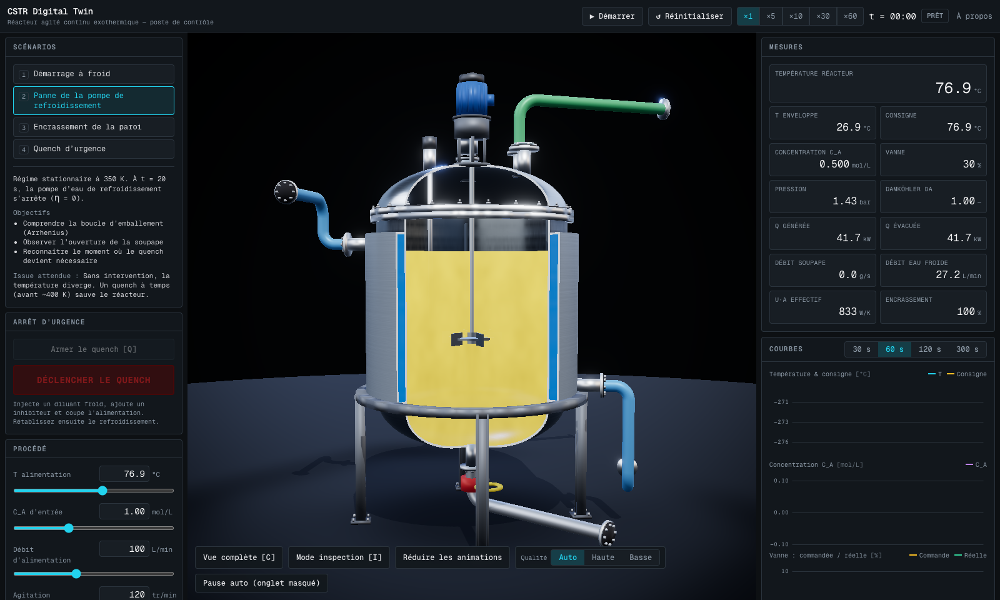
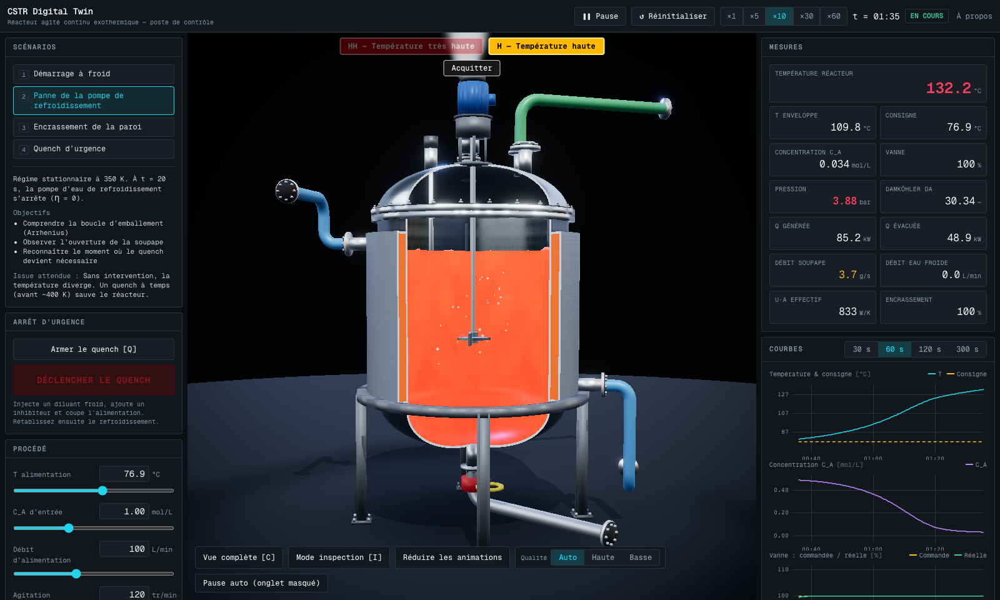
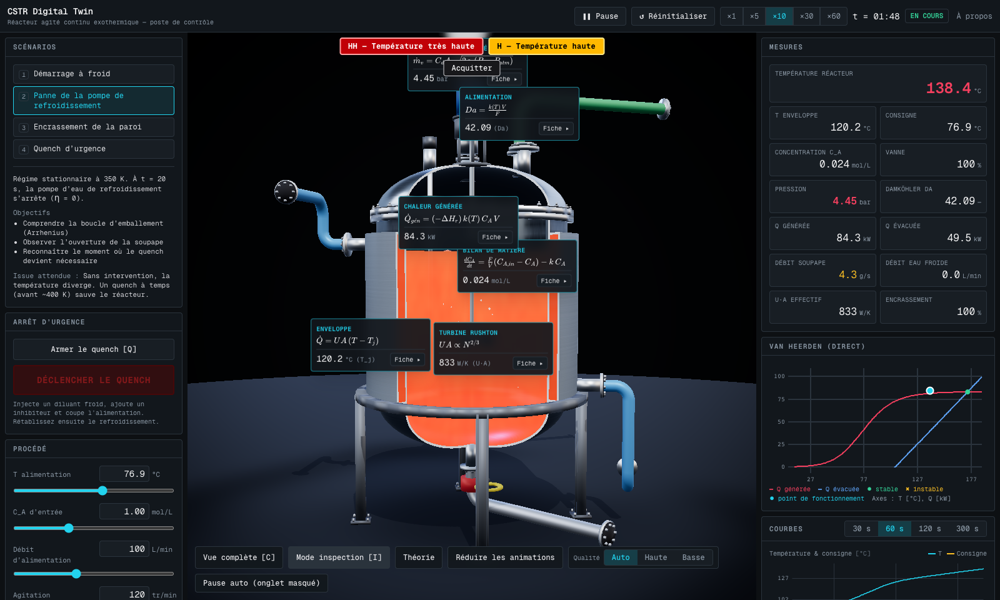
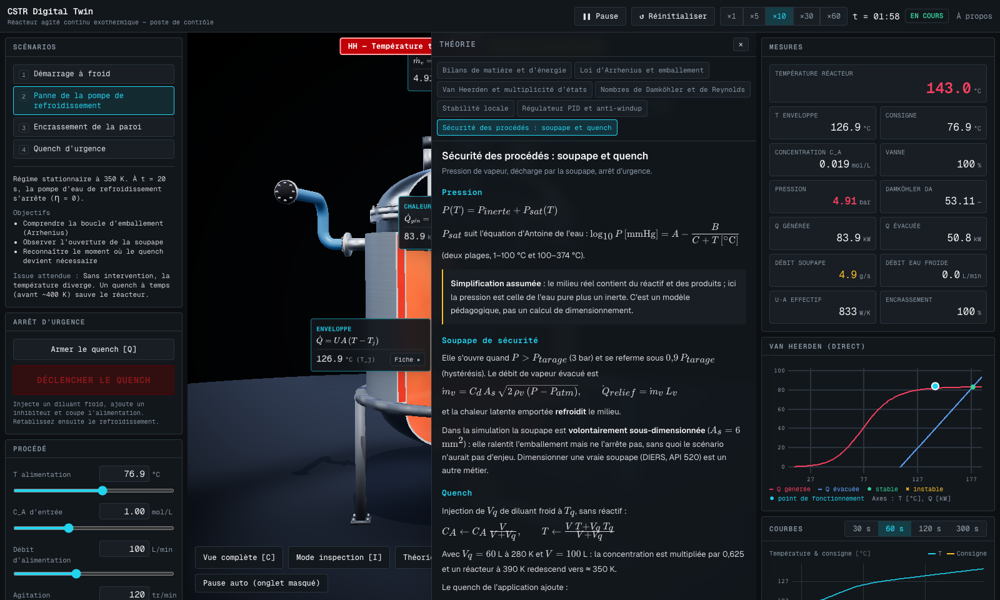

# 🧪 CSTR Digital Twin

[](https://github.com/yassineeljal/CSTR/actions/workflows/ci.yml)

Jumeau numérique d'un **réacteur chimique agité continu (CSTR) exothermique**, simulé à 60 Hz dans le navigateur, rendu en 3D temps réel (React Three Fiber + shaders GLSL) et piloté depuis un poste de contrôle de style SCADA. Emballement thermique (loi d'Arrhenius), régulation PID, soupape de sécurité, quench d'urgence, mode d'inspection académique avec formules vivantes.

> Projet conjoint **Génie Chimique** (Polytechnique Montréal) × **Génie Logiciel / 3D** (ÉTS).



| Emballement thermique                           | Mode inspection                                   | Fiche théorique                            |
| ----------------------------------------------- | ------------------------------------------------- | ------------------------------------------ |
|  |  |  |

## Ce que fait l'application

- **Simulation physique rigoureuse** : bilans de matière et d'énergie, double enveloppe avec vanne, pression de vapeur (Antoine), soupape à hystérésis. Intégrateur RK4 à pas fixe (0,01 s) avec sous-découpage adaptatif, PID discret à action inverse avec anti-windup et transfert sans à-coup. Deux jeux de paramètres : benchmark de Seborg et hydrolyse de l'oxyde de propylène (cinétique de Fogler).
- **4 scénarios** : démarrage à froid, panne de la pompe de refroidissement, encrassement, quench d'urgence. Un parcours de sauvetage complet est couvert par un test e2e.
- **Poste de contrôle** : commandes procédé, PID (Auto/Manuel), quench en deux temps, mesures à 10 Hz colorées par niveau d'alarme, 4 courbes temps réel, alarmes selon ISA-18.2 (acquittement, retour à la normale non acquitté), journal, presets (localStorage + import/export JSON validé), raccourcis clavier.
- **3D** : cuve, enveloppe, chicanes et agitateur procéduraux (coupe animée par shader), pièces détaillées modélisées sous **Blender** (script `bpy` versionné, `.glb` Draco de 52 ko), fluide thermique avec vortex et ébullition, bulles et vapeur calculées sur GPU, Bloom, vibration à l'approche de la rupture.
- **Mode inspection** : étiquettes 3D (formule KaTeX + valeur vivante), 7 fiches théoriques, diagramme de Van Heerden en direct.
- **Robustesse** : rendu à la demande (coût nul au repos), qualité adaptative, pause automatique de l'onglet masqué, repli 2D sans WebGL, boundary d'erreur.

## Lancer en local

```bash
pnpm install
pnpm dev                 # http://localhost:3000
pnpm test                # tests unitaires (Vitest)
pnpm test:e2e            # tous les parcours (Playwright, build de production)
pnpm test:e2e:3d         # scène 3D, captures, performance (rendu WebGL réel)
PERF_GPU=1 pnpm test:e2e:3d   # idem avec le GPU de la machine
```

Liens directs utiles : `/?scenario=pump-failure&speed=10&autostart=1` (scénario lancé), `/?kiosk=1` (scène seule), `/debug` (valeurs brutes du moteur).

### Notebooks (équipe Génie Chimique)

```bash
cd notebooks
python3 -m venv .venv && source .venv/bin/activate
pip install -r requirements.txt
jupyter lab                      # 01 validation · 02 Van Heerden · 03 PID · 04 scénarios
python export_golden.py          # régénère tests/golden/ (trajectoires SciPy de référence)
python check_golden.py           # vérifie qu'elles sont à jour (utilisé en CI)
```

### Modèles 3D (Blender 5.x)

```bash
pnpm geometry:export             # tools/blender/geometry.json depuis src/simulation/geometry.ts
blender -b --factory-startup --python tools/blender/build_reactor_assets.py -- \
        --out public/models/reactor-details.glb
```

## Architecture

```
┌──────────────── Thread principal ────────────────┐      ┌────────── Web Worker ──────────┐
│ HUD React ──commandes──► SimulationClient ───────┼─────►│ SimulationHost                  │
│   ▲  état lent (Zustand)      │ onmessage        │      │  accumulateur ─► RK4 (0,01 s)   │
│   └── alarmes / mode ◄────────┤                  │      │             ─► PID (0,1 s)      │
│                    simRef (Float64Array mutable) │◄─────┤             ─► scénario, alarmes│
│   useFrame (R3F) ◄──┘     └─► graphes uPlot      │      │  snapshot transférable ≈ 60 Hz  │
└──────────────────────────────────────────────────┘      └─────────────────────────────────┘
```

- `src/simulation/` : cœur physique **pur** (aucun import React/Three), testable sous Node.
- Aucune donnée rapide (60 Hz) dans l'état React : lecture directe dans `useFrame` et dans des `ref` DOM à 10 Hz.
- `SimulationTransport` : le Worker local pourrait être remplacé par un serveur WebSocket sans toucher à l'UI.

Décisions d'architecture : [`docs/decisions/`](docs/decisions/) · Modèle et écarts justifiés par rapport au plan : [`docs/model.md`](docs/model.md) · Plan d'origine : [`docs/PLAN.md`](docs/PLAN.md).

## Validation

| Niveau                                                                    | Résultat                                                                                                                                |
| ------------------------------------------------------------------------- | --------------------------------------------------------------------------------------------------------------------------------------- |
| Moteur TS vs SciPy (10 trajectoires, 2 jeux de paramètres, jusqu'à 456 K) | écart relatif max **< 3·10⁻⁸** (exigence : 0,5 %)                                                                                       |
| Tests unitaires (Vitest)                                                  | **270+**, couverture de lignes ≈ 96 %                                                                                                   |
| Tests e2e (Playwright, build de production)                               | **26** : 15 « ui » (HUD complet en mode 2D, sans WebGL), 10 « 3d » (scène, inspection, perf, qualité), 1 test de fumée 3D exécuté en CI |
| Formules des fiches théoriques                                            | compilées en mode strict par KaTeX dans les tests                                                                                       |
| Lighthouse (desktop)                                                      | **100 / 100 / 100 / 100**                                                                                                               |

Performances mesurées : voir [`docs/perf.md`](docs/perf.md) (moteur 0,031 ms par tick ; 90 draw calls ; ≈ 58 FPS ; mémoire GPU stable sur 10 min).

## Limites connues (à lire avant d'utiliser les chiffres)

- Pression = eau pure + inerte ; volume constant ; mélange parfait ; soupape **volontairement sous-dimensionnée**.
- Les valeurs marquées `TODO(chem)` dans `src/simulation/presets/` ne sont **pas validées** par l'équipe Génie Chimique. Les conditions du jeu « oxyde de propylène » (C_A,in = 4 mol/L…) sont des hypothèses pédagogiques choisies pour obtenir trois états stationnaires.
- Plusieurs paramètres diffèrent du plan initial (capacité thermique de paroi, enveloppe redimensionnée, seuils d'alarme, quench avec arrêt d'alimentation) : justifications chiffrées dans `docs/model.md` §2.
- Non réalisés : sélecteur FR/EN (optionnel), persistance Supabase (optionnelle), architecture B (backlog).

## Déploiement (Vercel)

L'application est 100 % statique côté serveur (`next build`), le moteur tourne dans le navigateur.

1. Importer le dépôt sur Vercel (preset Next.js, commande de build par défaut `pnpm build`).
2. Définir `NEXT_PUBLIC_SITE_URL` (URL publique : aperçus de partage et sitemap).
3. Chaque pull request obtient une URL de preview ; `main` part en production.
4. Domaine personnalisé : _Project → Settings → Domains_, puis l'enregistrement DNS indiqué (HTTPS automatique).
5. Vérifier sur la preview que le worker est bien servi (`/debug` affiche « worker : OK »).

## Crédits

- S. Seborg, T. Edgar, D. Mellichamp, F. Doyle — _Process Dynamics and Control_ (benchmark CSTR).
- H. S. Fogler — _Elements of Chemical Reaction Engineering_ (cinétique de l'oxyde de propylène).
- E. Paul, V. Atiemo-Obeng, S. Kresta — _Handbook of Industrial Mixing_ (proportions de cuve agitée).
- Three.js, React Three Fiber, drei, postprocessing, uPlot, KaTeX, Zustand, Next.js, Vitest, Playwright.

Licence : [MIT](LICENSE).
